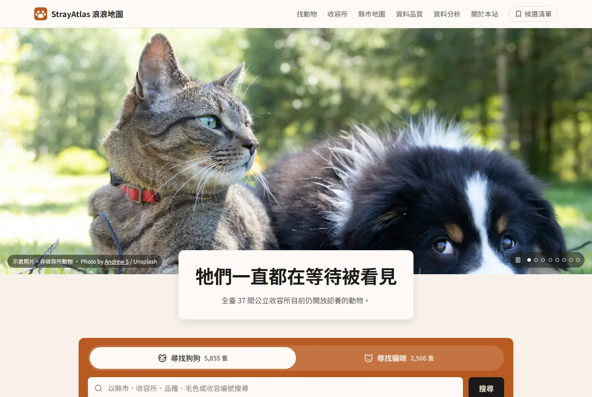
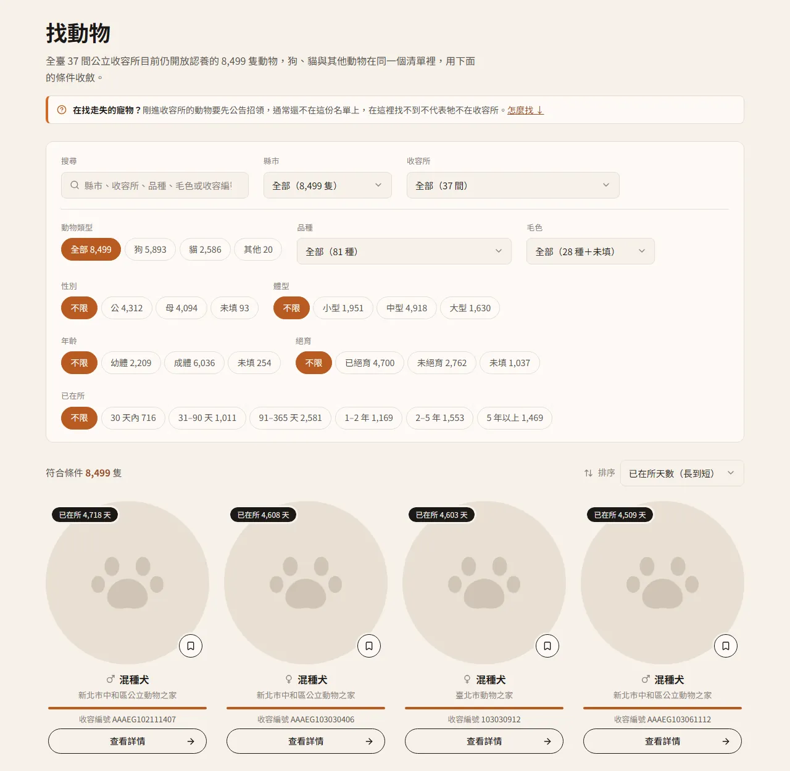
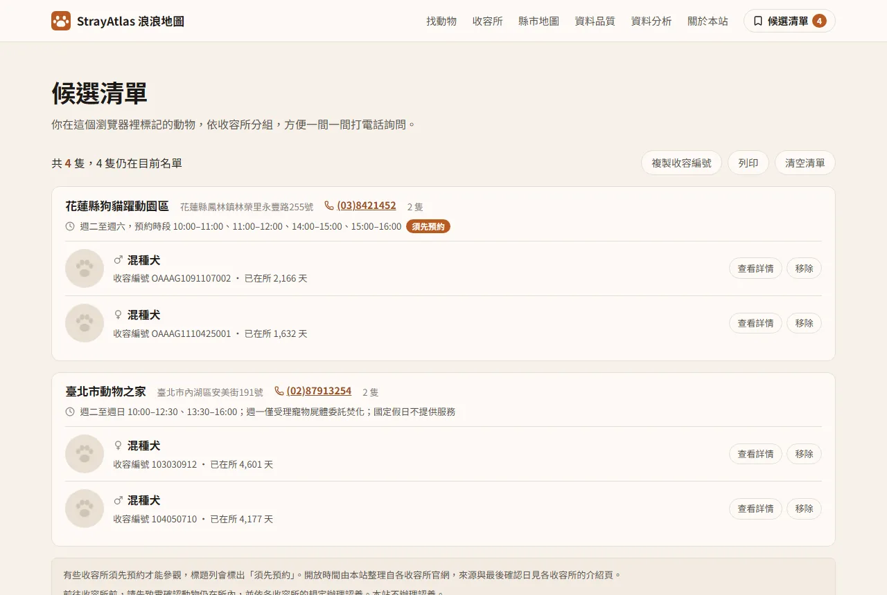
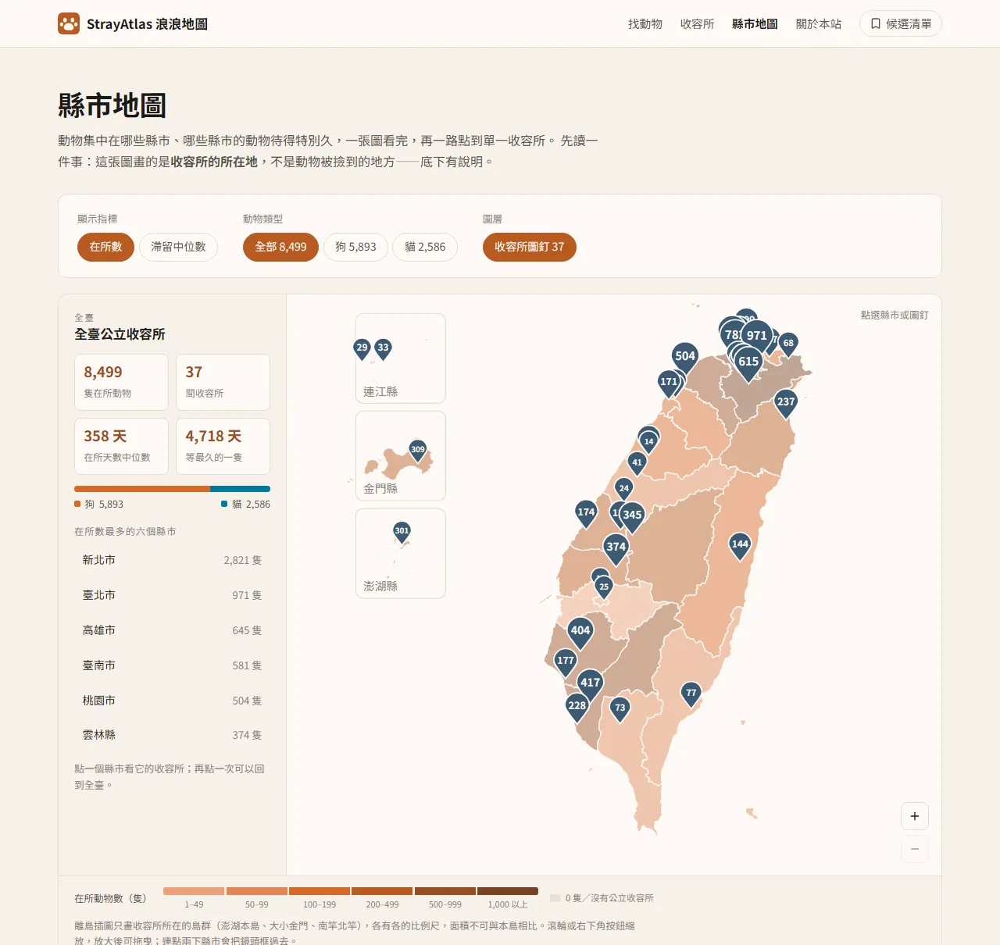
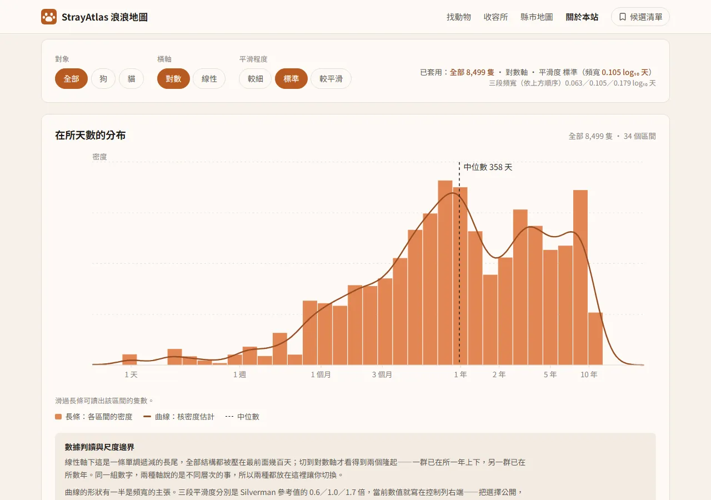
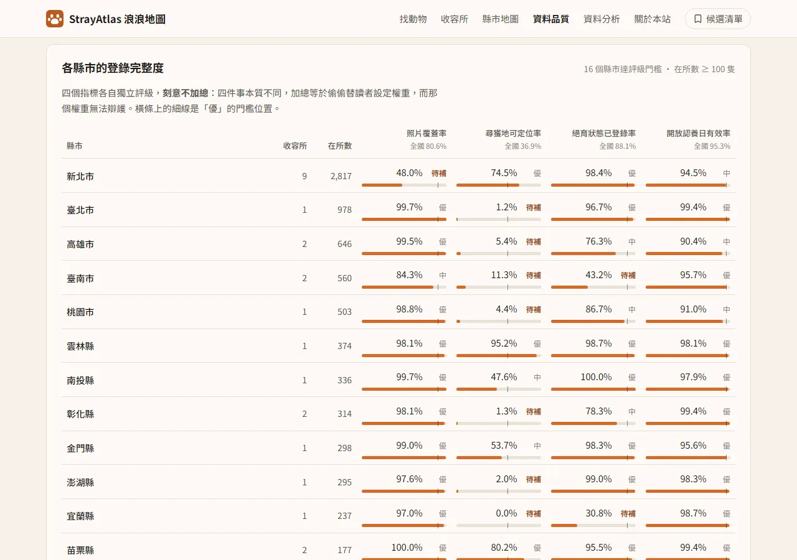

# StrayAtlas 浪浪地圖

臺灣公立動物收容所開放資料的分析與互動視覺化。

**Demo**：<https://jen-chieh-yu.github.io/stray-atlas/>

---

## 這個專案在做什麼

農業部「動物認領養」開放資料每日更新，內容是**此刻仍開放認養**的動物名冊。本專案每日自動保存快照並重建網站資料：清理欄位、為自由文字的尋獲地分級（刻意不轉成座標），並以互動地圖與分析頁呈現收容所的滯留狀況。

這份資料有幾個反直覺的陷阱，處理不當會得到看似漂亮但站不住腳的結論。**如何避開這些陷阱，是本專案想展示的重點**，勝過任何單一結論：資料限制、我踩過的統計陷阱，以及為什麼沒有尋獲地熱區圖，寫在 [docs/METHODOLOGY.md](docs/METHODOLOGY.md)；技術選擇與理由在 [docs/ARCHITECTURE.md](docs/ARCHITECTURE.md)。

---

## 網站功能

資料每天自動更新，頁尾標示目前使用的快照日期。截圖裡的動物照片以腳掌圖示代替：照片由各收容所拍攝，本站只以原網址顯示、不轉存（見〈資料來源與授權〉）。

### 找動物

全部 8,000 餘隻動物在同一份清單，可用縣市、收容所、品種、毛色、性別、體型、年齡、絕育與已在所天數篩選，搜尋也認得收容編號。點開卡片是詳細資料，網址可以直接分享，貼到 LINE 或 Facebook 會帶出該動物的照片與品種。

### 收容所

收容所列表可依縣市篩選、七種排序。每間收容所的介紹頁有在所動物與在所時間分布，以及本站人工整理的開放時間、參觀方式與認養須知連結，每筆都附來源與最後確認日。

### 候選清單

在卡片上按書籤，就把動物加入候選清單。清單依收容所分組，附電話與開放時間，須先預約的收容所會標出來；可以複製收容編號或列印，方便一間一間打電話詢問。清單只存在這個瀏覽器，不需要帳號。

### 縣市地圖

各縣市依在所動物數或滯留天數中位數分級著色，加上 37 處收容所圖釘，可縮放平移、點進縣市或單一收容所。圖上畫的是**收容所的所在地**，不是動物被撿到的地方（原因見 [docs/METHODOLOGY.md](docs/METHODOLOGY.md)〈尋獲地〉）。

### 資料分析

在所天數的分布：長條圖加核密度曲線，可切換對數／線性軸與三段平滑程度；另有犬貓累積分布、分位數表、各分組的中位數，以及在同一間收容所之內比較毛色。頁面先講清楚這份資料的偏誤，才放圖表。

### 資料品質

同一份開放資料，各縣市的填法差很多。這頁列出被丟掉的欄位、各欄的填寫率，以及各縣市四項登錄完整度的評級；門檻是本站手選並寫在頁面上，刻意不加總成一個分數。

另有首頁（全站數字、等最久的動物、認養流程）與關於本站（資料來源、更新頻率、技術選擇、免責聲明）。

---

## 文件

| 文件 | 內容 |
|---|---|
| [docs/METHODOLOGY.md](docs/METHODOLOGY.md) | 資料判讀：資料限制、我踩過的統計陷阱、尋獲地為什麼不畫熱區圖 |
| [docs/ARCHITECTURE.md](docs/ARCHITECTURE.md) | 技術棧與架構決策的理由 |
| [docs/DEVELOPMENT.md](docs/DEVELOPMENT.md) | 本機執行（clone 後 `npm ci`、`npm run dev` 即可）、提交前檢查、由快照重建資料、專案結構 |
| [docs/DATA-PIPELINE.md](docs/DATA-PIPELINE.md) | 資料來源細節、每日快照與稽核、儲存成本、部署、收容所資訊的維護 |
| [DESIGN.md](DESIGN.md) | 介面規格與設計約束 |
| [PROJECT_BRIEF.md](PROJECT_BRIEF.md) | 資料剖析結論與已驗證的數字 |
| [CLAUDE.md](CLAUDE.md) | 與 AI 協作的工作規則：Git 慣例、交付流程 |

---

## 資料來源與授權

| 項目 | 來源 | 授權 |
|---|---|---|
| 動物名冊 | 農業部「動物認領養」，[政府資料開放平臺 dataset 85903](https://data.gov.tw/dataset/85903)，每日更新 | 政府資料開放授權條款第 1 版 |
| 行政區界線 | 內政部「鄉鎮市區界線」，dataset 7441 | 政府資料開放授權條款第 1 版 |
| 收容所開放時間、參觀方式、認養須知連結 | 本站人工整理自各收容所與主管機關官網，存在 `data/reference/shelter-info.json`，每筆附來源網址與最後確認日 | 只記錄事實並附出處，認養規定只連結、不轉抄 |

**本專案目前保留所有權利，尚未選定開放授權條款。**

資料源授權與程式碼授權無關，另行標示：

> `data/` 目錄下之資料來源為農業部「動物認領養」開放資料，依政府資料開放授權條款第 1 版使用。

動物照片由各公立動物收容所拍攝登錄，經[全國動物收容管理系統](https://www.pet.gov.tw/AnimalApp/AnnounceMent_Announce.aspx)（pet.gov.tw）公開；本站僅以原網址連結顯示，不下載、不轉存，分享連結的預覽圖也直接使用該網址。資料集只提供照片網址，來源沒有說明照片本身的授權範圍（2026-10-07 查證，見 DESIGN.md §10〈分享〉）。因此本文件的截圖也不含動物照片，以腳掌圖示代替。

首頁的示意照片來自 Unsplash，依 Unsplash License 使用，攝影師與出處見 `THIRD-PARTY-LICENSES` 與網站的關於本站頁。照片中的動物不在臺灣的收容所。
